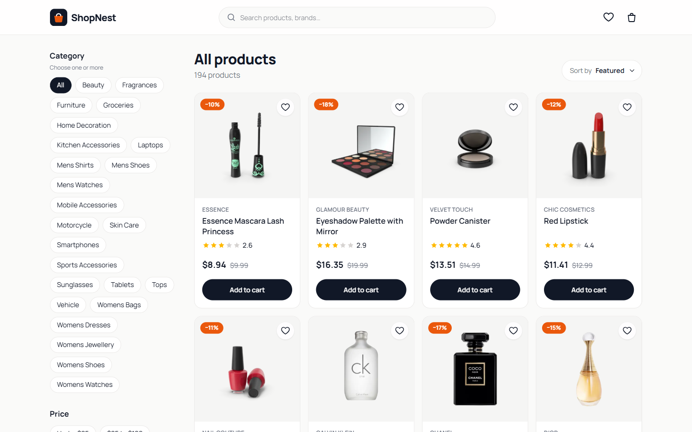
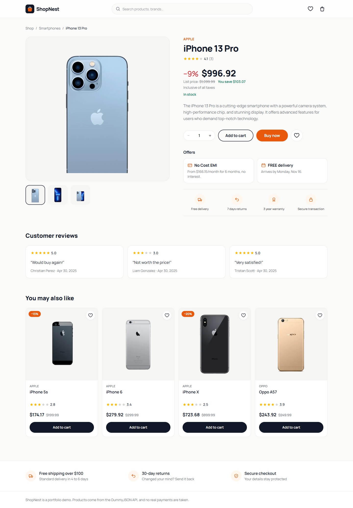
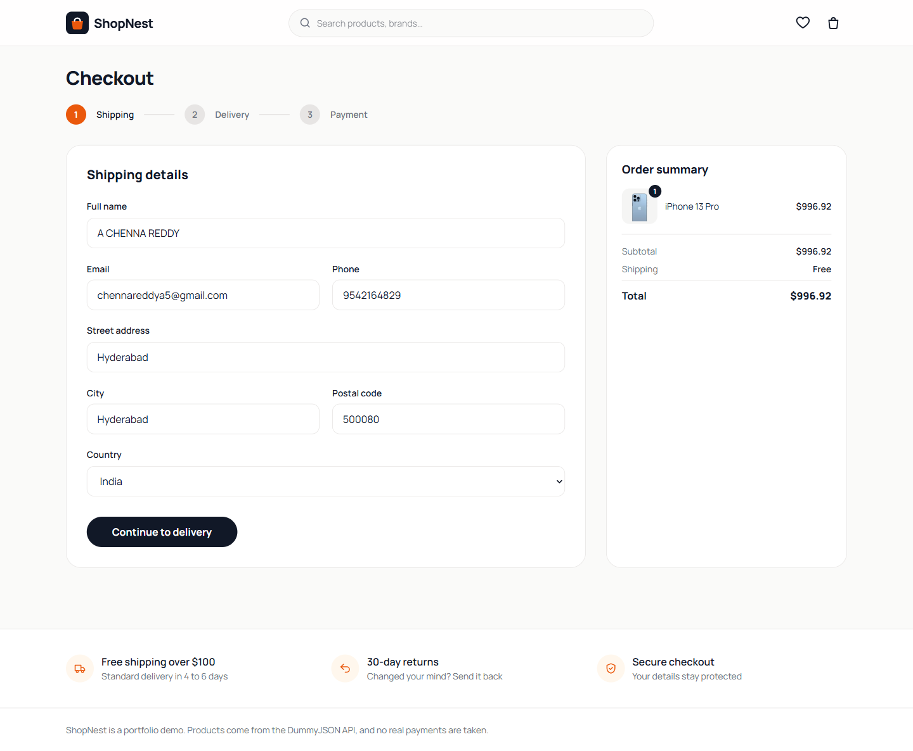
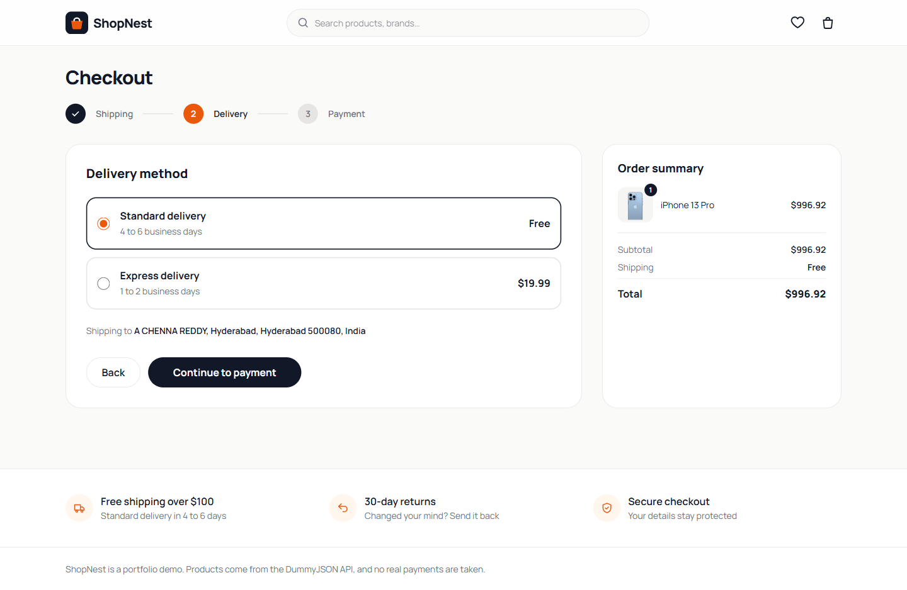
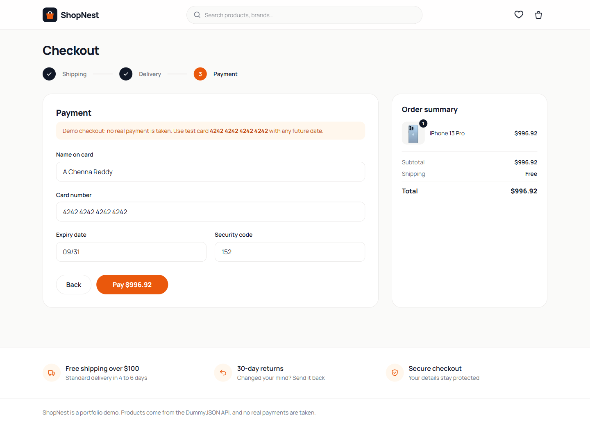
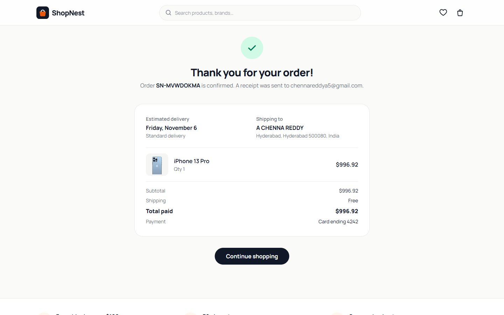

# ShopNest: React E-commerce Storefront

A complete online store front end: product search and filters, product pages, a persistent cart and wishlist, and a validated multi-step checkout.

**Live demo:** https://chennareddy-shop.vercel.app



## Features

- **Product catalog** with search, category filter, price range, in-stock filter, sorting and pagination
- **Custom sort dropdown** following the ARIA listbox pattern (arrow keys, Enter, Escape, click outside)
- **Shareable filters:** every filter lives in the URL, so a filtered page can be bookmarked or sent to someone
- **Product pages** with image gallery, Amazon-style pricing (discount, list price, savings), stock status, offers (No Cost EMI, delivery date), service highlights, reviews and related products
- **Buy now** checks out a single product without touching the cart, like Amazon
- **Cart and wishlist** saved in the browser (Zustand `persist`), so they survive a refresh
- **Free-shipping progress bar** and delivery options that update the order total
- **3-step checkout** (shipping, delivery, payment) with field validation, card number formatting, a Luhn check, and focus moving to the first error
- **Order confirmation** page with estimated delivery date
- **Loading skeletons, empty states and error states** with retry
- **Accessible:** labeled form fields, `aria-invalid` errors, keyboard-friendly controls, live-region toasts
- **Code-split pages** so the shop loads first and other pages load on demand
- **Unit tests** (Vitest) for catalog filtering, cart rules and form validation

   ### Product page

   

   ### Checkout flow

   | 1. Shipping | 2. Delivery |
   | --- | --- |
   |  |  |
   | **3. Payment** | **4. Order confirmed** |
   |  |  |

## Tech stack

React 19, TypeScript, Vite, Tailwind CSS v4, React Router, Zustand, Vitest. Product data from the [DummyJSON](https://dummyjson.com) API.

## How it's built

```
src/
  lib/          api (cached fetches), catalog (filter/sort/paginate), pricing, validation
  store/        Zustand stores: cart, wishlist, orders, toasts
  hooks/        useAsync (loading, errors, cancellation, retry)
  components/   header, product card, filters, pagination, form field, order summary
  pages/        shop, product, cart, checkout, order confirmation, wishlist
```

Business rules (filtering, cart quantities, shipping costs, validation) are plain functions in `lib/` and `store/`, separate from the components, which keeps them easy to read and to test.

## Run locally

```bash
npm install
npm run dev     # start the dev server
npm test        # run the unit tests
npm run build   # production build
```

Use test card `4242 4242 4242 4242` with any future expiry date at checkout. No real payment is taken.
